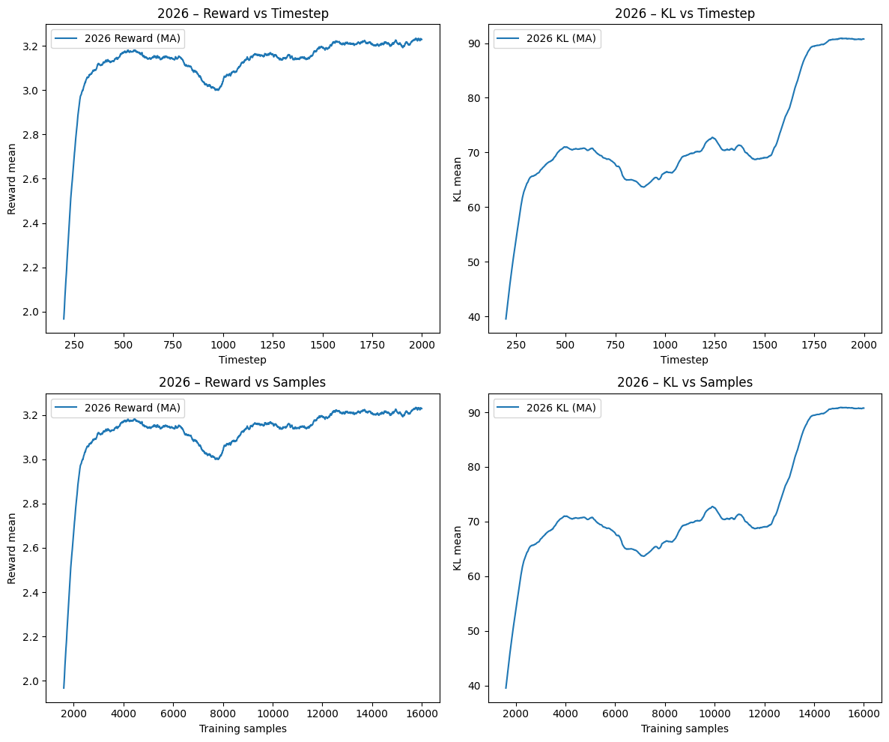
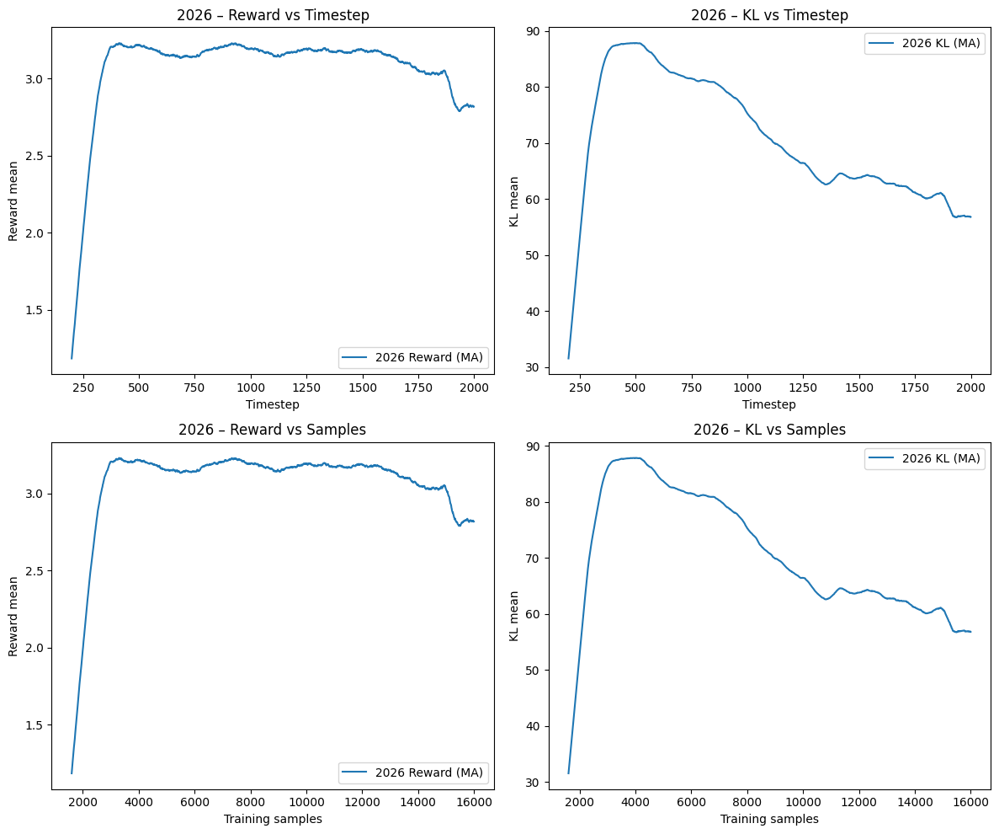
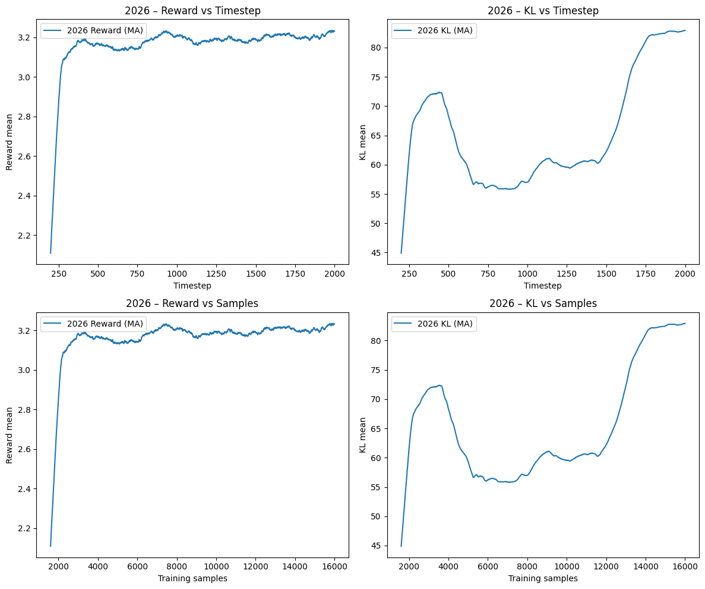
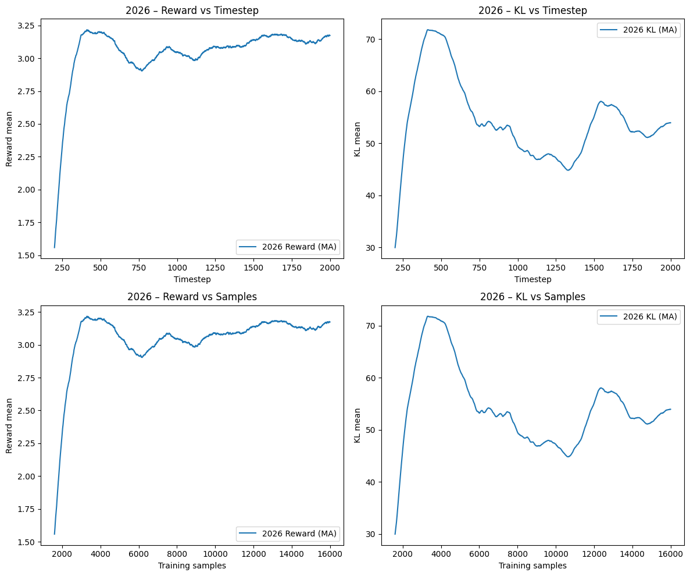

# ProteinTuneRL — antibody infilling with reinforcement learning

Research fork of [LLNL/protein_tune_rl](https://github.com/LLNL/protein_tune_rl),
maintained by **Ruman Shaikh**. This fork extends IgLM-based CDR-H3 infilling with
token-level A2C and Generalised Advantage Estimation (GAE), online-RL correctness
fixes, and independent sequence and structure evaluation.

The work studies **proxy optimisation versus policy drift**, not experimentally
validated improvements in antibody binding or function. Original authors retain
full attribution; see [upstream documentation](README.upstream.md).


## What this fork adds

| Area | Contribution |
| --- | --- |
| Online optimisation | Token-level A2C critic with GAE, terminal rewards, and truncation-aware value bootstrapping |
| Probability consistency | Match PPO recomputed log probabilities and reference scoring to the sampler's constrained vocabulary |
| Baselines and KL | Prompt-only learned PPO baseline; corrected scalar adaptive KL controller; KL-inclusive REINFORCE reward baseline |
| Training mechanics | Policy-device-aware critics, optional PPO gradient clipping, epoch reshuffling, and elapsed-time logging |
| Reward scope | Optional generated-region-only composition scoring; folding-failure fallback handling |
| Sequence evaluation | Batched ESM-2 masked pseudo-log-likelihood for the heavy chain or generated span |
| Structure evaluation | Reference-PDB framework alignment, backbone RMSD, region-length difference, SASA, and mean B-factor |
| Regression tests | Tensor-level RL tests, tiny-model CPU/DDP optimizer checks, and ESM/PDB evaluation tests |

Online methods include REINFORCE, PPO, and A2C. Offline DPO and DRO are also
available. Algorithm names do not imply a controlled or multi-seed benchmark.

## Quickstart

Python 3.9+ is declared by the package; the regression suite has been exercised
with Python 3.10. Model weights are supplied separately.

```bash
git clone --branch new_algo https://github.com/ruman-shaikh/protein_tune_rl.git
cd protein_tune_rl
python -m venv .venv
source .venv/bin/activate
python -m pip install -e '.[dev]'
```

Set the path to an IgLM weights/tokenizer directory, generate configs from the
templates, and review their dataset paths, run length, and output directory:

```bash
export IGLM_DIR=/absolute/path/to/IgLM/iglm/trained_models/IgLM-S
python configs/examples/patch_iglm_dir.py --value "${IGLM_DIR}"
python -m protein_tune_rl.tune \
  --config-file configs/examples/a2c_iglm_hcdr3_beta_sheet.json
```

Use the corresponding `ppo`, `reinforce`, or `explicit_kl_reinforce` config to
select another online method. Folding-based rewards additionally need the
optional `folding` extra and the relevant IgFold dependencies. Composition
rewards and ESM/PDB evaluator tests do not require IgFold.

**CPU caveat:** optimizer tests support CPU, but training checkpoint save/resume
still assumes CUDA RNG state. CPU training is not currently end-to-end
checkpoint-safe; see [upstream issue #4](https://github.com/llnl/protein_tune_rl/issues/4).

## Independent evaluation

ESM-2 scores sequence compatibility with a frozen model, not experimental affinity:

```bash
python scripts/evaluate_esm.py \
  data/examples/eval_data_50_v3.csv results/esm2_eval.csv \
  --device cpu --limit 5
```

The first run may download the model. Add `--local-files-only` for cached weights;
use `--device cuda` when appropriate. Mean/sum reduction and region-only scoring
are also exposed by `ESMSequenceScoring` through the metric factory.

For a matched reference and predicted structure:

```bash
python scripts/compare_pdb_structures.py reference.pdb predicted.pdb \
  --reference-region 95:107 --predicted-region 95:107 \
  --reference-chain H --predicted-chain H --output comparison.json
```

Bounds are one-based inclusive sequence positions, not PDB residue identifiers.
See [ESM/PDB usage and interpretation](docs/ESM_PDB_EVALUATION.md).

## Validation

```bash
python -m pytest tests -q
```

The suite contains **17 tests**, using synthetic tensors, fake ESM models,
synthetic PDBs, and a tiny randomly initialised GPT-2. It requires neither IgLM
weights nor a GPU. The CPU/Gloo integration tests need permission to open a local
rendezvous socket; restrictive sandboxes can block their setup.

The previously recorded five-sequence cached ESM-2 GPU smoke test took 9.5 seconds,
with mean whole-chain log probability −2.367 and HCDR3 log probability −3.051.
These are implementation smoke-test results, not trained-policy benchmarks.
See [project status](PROJECT_STATUS.md) for validation scope and pending work.

## Research report and figures

- [Report source](paper/main.tex) and [report PDF](paper/ProteinTuneRL_A_Reinforcement_Learning_Perspective_on_Antibody_Design.pdf).
- [Figure reproduction script](paper/make_plots.py), using retained local run logs.
- [Project article](https://medium.com/@ruman_shaikh/proteintunerl-a-reinforcement-learning-perspective-on-antibody-design-7d6e4d2a5a35).

Existing figures describe individual historical runs, not multi-seed evidence that
one algorithm produces better antibodies. Run settings differ across methods.
Historical plots/report claims should not be assumed to describe every later
correctness fix or the current logging semantics.

| PPO | A2C + GAE |
| --- | --- |
|  |  |

| REINFORCE | Explicit-KL REINFORCE |
| --- | --- |
|  |  |

## Limits and preserved research data

- `ss_perc_sheet` is Biopython's amino-acid-composition statistic, **not a structure prediction**. Region-only scoring requires recalibrated normalisation.
- The online trainer supports one reward metric per run; multi-objective reward composition remains future work.
- Stop-token credit and empty-action/multi-rank advantage-normalisation boundaries need review; current tests are not exhaustive distributed validation.
- Folding-metric default options and retry cleanup still have edge cases; fallback handling does not cover every failure path.
- Region RMSD is undefined for unequal loop lengths. B-factor is pLDDT only when the structure producer uses that field for pLDDT.
- Bundled data have no antigen complexes or experimental affinity labels and cannot supply docking ground truth. External matched structures are needed.
- Imperial HPC access has ended; cluster scaffolding was removed. **Research data, logs, checkpoints, figures, and reports are retained.**

`test_run/` outputs and `IgLM/` model weights are intentionally ignored by Git and
are **not backed up by a push**. Paper source, final report, figures, and plotting
scripts are versioned; LaTeX auxiliary build records stay local.

## Public upstream contributions

Six issues were submitted to LLNL under `ruman-shaikh`. These are **bug reports
and feature proposals, not merged PRs**:

1. [Adaptive KL controller normalisation and scalar coefficient](https://github.com/llnl/protein_tune_rl/issues/1)
2. [Sampling/PPO/reference probability-support consistency](https://github.com/llnl/protein_tune_rl/issues/2)
3. [Prompt-only PPO learned baseline](https://github.com/llnl/protein_tune_rl/issues/3)
4. [CPU checkpoint save/restore](https://github.com/llnl/protein_tune_rl/issues/4)
5. [Optional ESM-2 evaluator](https://github.com/llnl/protein_tune_rl/issues/5)
6. [Token-level A2C with GAE](https://github.com/llnl/protein_tune_rl/issues/6)

## Attribution and licence

Original framework: LLNL and contributors. Original paper: Lee, Hayes,
Vashchenko, and Landajuela, *Reinforcement Learning for Antibody Sequence Infilling*
(2025), [doi:10.1101/2025.08.08.669419](https://doi.org/10.1101/2025.08.08.669419).
The full upstream citation is preserved in [README.upstream.md](README.upstream.md).

[MIT licence](LICENSE), [NOTICE](NOTICE), LLNL-CODE-2006374. Third-party model
weights and dependencies retain their own licences.
